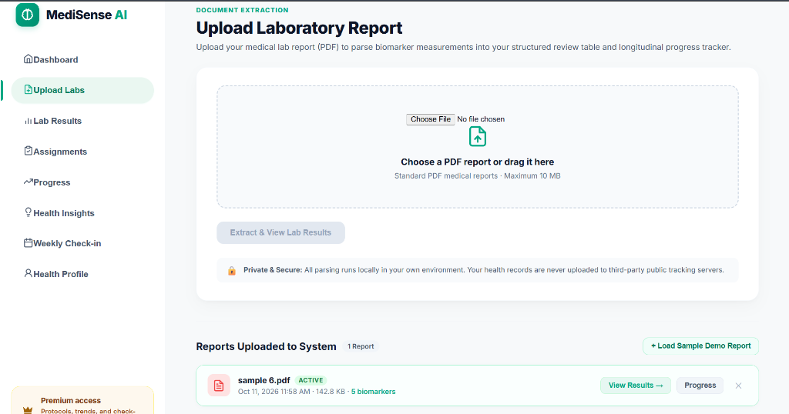
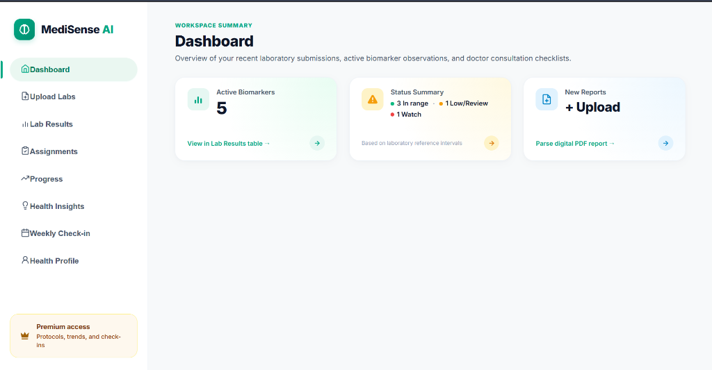
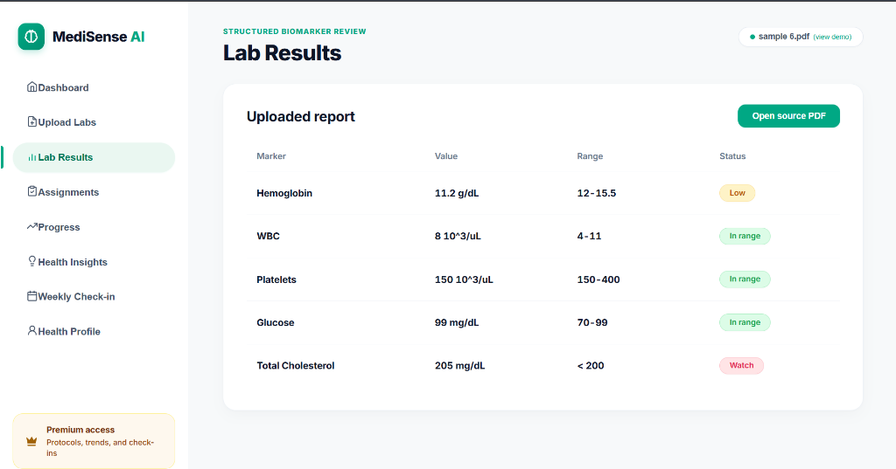
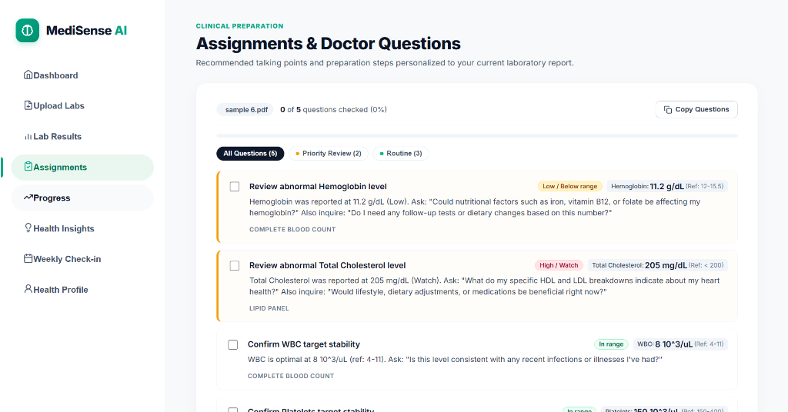
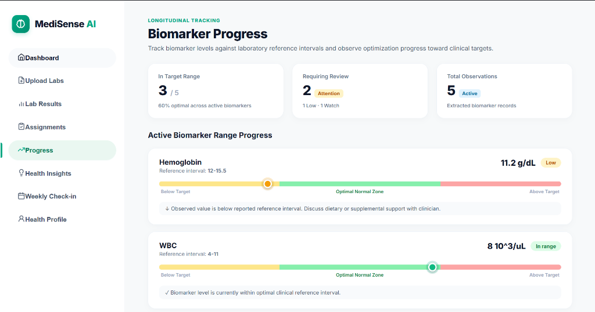

# MediSense AI — Medical Reports, Made Clear

[](https://www.python.org/)
[](https://fastapi.tiangolo.com/)
[](https://react.dev/)
[](https://vitejs.dev/)
[](https://mistral.ai/)
[](LICENSE)

**MediSense AI** is a patient-friendly medical intelligence platform designed to transform complex, intimidating laboratory PDF reports into clear, structured, and actionable health insights.

---

## ✨ Features

- 📄 **Intelligent Lab PDF Extraction**
  - High-precision extraction of test names, observed values, units, and reference intervals across standard formats (CBC, CMP, Lipid Panels, Thyroid, Iron Panels, etc.).
  - Handles single-page and multi-page medical PDFs with automated table detection.

- 📊 **Interactive Lab Results Dashboard**
  - Clear patient-oriented status badges: `Within lab range`, `Below lab range`, `Above lab range`, and `Needs verification`.
  - Built-in biological plausibility checks to identify extracted outliers or scanning anomalies.
  - Detailed side-drawer educational guides for individual biomarkers (what it is, why it matters, clinical targets).

- 📋 **Dynamic Doctor Consultation Checklist ("Assignments & Doctor Questions")**
  - Automatically analyzes current lab findings to generate personalized talking points for upcoming appointments.
  - Out-of-range markers (Low, High, Watch, Review) are prioritized at the top of the consultation list.
  - Interactive task checklist with real-time completion tracking and one-click clipboard export (`Copy Questions`).

- 💬 **Evidence-Grounded Health Insights**
  - Medical Q&A powered by **Mistral AI** (`open-mistral-7b`) and local vector retrieval (Sentence-Transformers + FAISS).
  - Strict grounding: answers only cite verified reference passages (`[S1]`, `[S2]`) from MedlinePlus, NIH, and AHA.
  - Integrated safety guardrails and acute emergency symptom detection (e.g., chest pain, shortness of breath).

- 📈 **Longitudinal Biomarker Progress Tracking**
  - Visual range meters plotting your exact results against clinical low and high reference thresholds.
  - Overview cards displaying the proportion of optimal vs. attention-requiring biomarkers.

---

## 🎥 MediSense AI — Project Demo

Watch the complete application walkthrough.

[▶️ **Watch MediSense AI Demo Video**](https://drive.google.com/drive/u/0/folders/1QXZ4m3TWQVkrr2EEYRZgryfat42oPnXr)


## 📸 Application Workflow & Visual Walkthrough

The platform is designed around a seamless, 5-step patient clinical workflow:

### 1. Document Extraction & Upload (`Upload Labs`)
Upload your clinical laboratory report PDF (CBC, Metabolic, Lipid, Thyroid, Iron panels, etc.) through the privacy-preserving dropzone, or instantly load an interactive sample demo report (`sample 6.pdf`). All parsing executes locally.



---

### 2. Workspace Summary (`Dashboard`)
Get an immediate high-level overview of your health portfolio: total active biomarkers, laboratory status distribution (`In range`, `Low/Review`, `Watch`), and quick action buttons to upload new reports or review data.



---

### 3. Structured Biomarker Review (`Lab Results`)
Inspect extracted laboratory tests organized in a high-clarity clinical grid with standardized numerical values, laboratory reference intervals, patient-friendly status badges (`In range`, `Low`, `Watch`), and direct access to source PDF documents.



---

### 4. Clinical Consultation Preparation (`Assignments & Doctor Questions`)
Prepare for upcoming doctor visits with a dynamic, personalized checklist of clinical talking points automatically synthesized from your abnormal biomarkers. Questions are prioritized into **Priority Review** and **Routine**, with real-time checkbox tracking and one-click clipboard export (`Copy Questions`).



---

### 5. Longitudinal Range Progress Tracking (`Biomarker Progress`)
Track how your observed numbers compare against clinical targets using visual multi-zone range meters (`Below Target`, `Optimal Normal Zone`, `Above Target`), accompanied by actionable educational notes for each biomarker.



---

## 🏗️ Project Architecture

```
MediSenseAI/
├── backend/
│   ├── api/                # FastAPI endpoint routers (reports, chat, health)
│   ├── data/index/         # Vector index and metadata
│   ├── rag/                # Embeddings, retrieval, and knowledge ingestion
│   ├── safety/             # Medical safety guardrails and citation validation
│   ├── schemas/            # Pydantic models for request/response validation
│   ├── services/           # PDF parsing, report analysis, and Mistral answer generation
│   ├── requirements.txt    # Python backend dependencies
│   ├── .env.example        # Environment variable template
│   └── main.py             # FastAPI entrypoint
├── frontend/
│   ├── src/
│   │   ├── components/     # React dashboard components & views
│   │   ├── data/           # Reference ranges and educational medical guides
│   │   ├── App.jsx         # Main application layout and state management
│   │   └── App.css         # Modern styling & design system
│   ├── package.json        # Frontend dependencies
│   └── vite.config.js      # Vite build configuration
├── docs/
│   └── screenshots/        # Visual walkthrough UI screenshots
├── package.json            # Root npm script orchestrator (npm start)
├── run.py                  # Single-command unified dev server launcher
├── run.bat                 # Windows one-click batch launcher
├── run.ps1                 # Windows PowerShell runner
└── README.md
```

---

## 🚀 Getting Started

### Prerequisites

- **Python:** 3.10 or higher
- **Node.js:** 18 or higher (with npm)
- **Mistral AI API Key:** [Get a free API key from Mistral Console](https://console.mistral.ai/)

---

### ⚡ Quick Start (Single Command)

Once your `.env` is configured and dependencies are installed, you can start the entire platform (FastAPI backend + Vite frontend + automatic browser launch) with **a single command** from the project root:

```bash
npm start
```

*Alternatively, use any of these single-command options:*
```bash
# Cross-platform Python runner
python run.py

# Windows Command Prompt
run.bat

# Windows PowerShell
.\run.ps1
```

> **What the single-command runner does:**
> - Automatically detects and clears any stuck processes on ports `8000` (FastAPI) and `5173` (Vite).
> - Concurrently boots the FastAPI server and Vite dev server with unified, color-coded logging (`[BACKEND]` / `[FRONTEND]`).
> - Waits for Vite to initialize and automatically opens [http://localhost:5173/](http://localhost:5173/) in your default browser.
> - Gracefully terminates all background services together on `Ctrl+C`.

---

### Installation

1. **Clone the repository:**
   ```bash
   git clone https://github.com/your-username/MediSenseAI.git
   cd MediSenseAI
   ```

2. **Configure Environment Variables:**
   Copy the example environment file into `backend/.env`:
   ```bash
   cp backend/.env.example backend/.env
   ```
   Open `backend/.env` and insert your Mistral API key:
   ```env
   MISTRAL_API_KEY=your_mistral_api_key_here
   MISTRAL_MODEL=open-mistral-7b
   RAG_MIN_SIMILARITY=0.30
   ```

3. **Install Backend Dependencies:**
   ```bash
   pip install -r backend/requirements.txt
   ```

4. **Install Frontend Dependencies:**
   ```bash
   cd frontend
   npm install
   cd ..
   ```

---

### Running the Application

#### Option 1: Single Command (Recommended)

Run the unified development script from the workspace root to start both backend and frontend together with automated browser launch:

```bash
npm start
```

*Or direct runner scripts:*
```bash
python run.py       # Python runner (Linux / macOS / Windows)
run.bat             # Windows CMD
.\run.ps1           # Windows PowerShell
```

#### Option 2: Run Services Separately

**Terminal 1 — Backend:**
```bash
cd backend
python -m uvicorn main:app --port 8000 --reload
```

**Terminal 2 — Frontend:**
```bash
cd frontend
npm run dev
```

---

### Access Endpoints

- **Web Application:** [http://localhost:5173/](http://localhost:5173/)
- **Backend API & Swagger Docs:** [http://localhost:8000/docs](http://localhost:8000/docs)
- **Health Check:** [http://localhost:8000/health](http://localhost:8000/health)

---

## 🔒 Security & Privacy

- **No Medical Data Retention:** Extracted report values are processed in memory and client-side storage unless explicitly configured otherwise.
- **Strict Evidence Grounding:** The AI engine will not fabricate diagnostic claims or speculate outside supplied reference literature.
- **Protected Secrets:** All API keys and environment configurations are strictly isolated in `.env` and excluded from version control.

---

## ⚠️ Medical Disclaimer

**MediSense AI is intended strictly for general informational, educational, and preparation purposes.** It does not provide medical diagnosis, prescribe treatments, or substitute for consultation with a licensed physician or healthcare professional. In the event of a medical emergency, immediately contact your local emergency services (e.g., 911).

---

## 📄 License

This project is licensed under the MIT License — see the [LICENSE](LICENSE) file for details.
